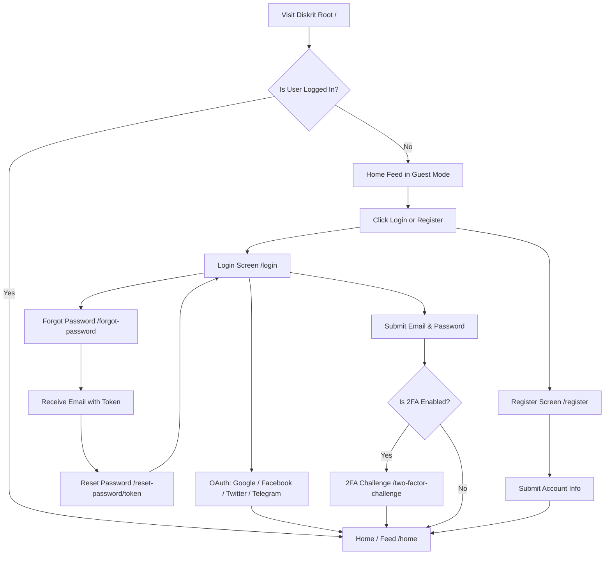
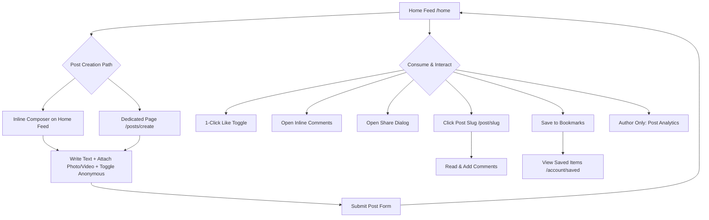
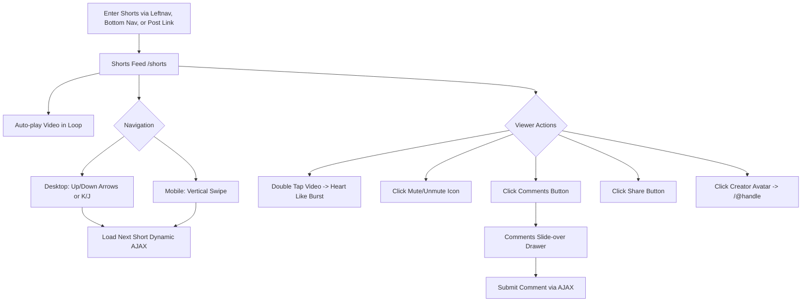
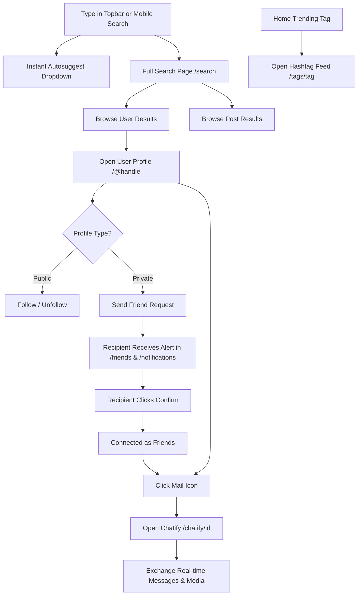
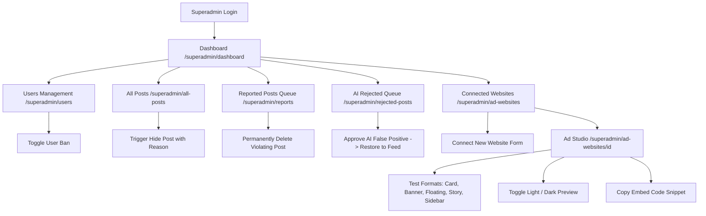

# Diskrit — UI/UX Page Inventory & User Flow Report
**Target Audience:** UI/UX Designer & Product Team  
**Date:** October 2026  
**Platform Version:** Diskrit PWA (Laravel 10 / Blade / TailwindCSS / Bootstrap / PWA)  
**Purpose:** Comprehensive baseline audit of existing pages, interface components, interaction models, and user journeys to guide the upcoming UI redesign.

---

## Executive Summary & Application Overview

**Diskrit** is a modern social networking Progressive Web Application (PWA) designed for fast, clean, and flexible content discovery. It blends traditional microblogging feeds, immersive vertical short-form video (similar to TikTok / YouTube Shorts), real-time direct and channel-based chat (Chatify), social networking (friends, followers, and Google Contacts sync), content moderation with AI safeguards, and an integrated Ad Network / WordPress syndicate publisher tool.

### Core System Modules
1. **Public & Legal Module:** Marketing overview, terms of service, privacy, cookies, and regulatory compliance documents.
2. **Authentication & Access Control:** Split-screen authentication covering login, registration, password recovery, and multi-factor authentication.
3. **Core Feed & Content Module:** Central feed with rich text / media / anonymous post creation, post interaction actions, video feeds, and dedicated single-post permalinks.
4. **Shorts / Reels Module:** Fullscreen immersive vertical video player with gesture and keyboard support, audio toggle, real-time sliding comment drawer, and share workflows.
5. **Social Graph & Discovery Module:** Search with live autosuggest, hashtag-driven topical feeds, user profiles (public vs. private), friend request management, and notifications.
6. **Account & Settings Module:** Comprehensive user account hub, profile & demographic customization, security controls, privacy rules, and a 21-day auto-expiring bookmarks library.
7. **Chat & Channels Module:** Real-time 1-on-1 messaging, persistent chat channels, announcement channels, public join links, and rich media exchange.
8. **Superadmin & Moderation Portal:** Operations center featuring analytics dashboards, user governance, post lifecycle controls, user report queues, AI moderation queues, and an interactive Ad Studio.
9. **Role-Based Admin Portals:** Role and permission delegation along with placeholder dashboards for Admin, Creator, and User tiers.

---

## 1. Complete Page Inventory

The table below catalogs every accessible UI screen across the application:

| Page | Module | Route | Purpose | Main Actions | Navigation |
|---|---|---|---|---|---|
| **Home / Feed** | Core Feed | `/home` (and `/`) | Main social stream displaying community posts, stories, and discovery widgets | Create post (text, photo, video, anonymous), like, comment, share, bookmark, report, filter by safe mode | Root redirect, Leftnav "Newsfeed", Topnav logo, Bottom nav Home icon |
| **Video Feed** | Core Feed | `/home?feed=video` | Filtered version of the newsfeed displaying only posts that contain video | Play videos, interact with posts, switch back to all posts | Leftnav "Videos", Bottom nav Video icon |
| **Shorts Feed** | Shorts / Reels | `/shorts` | Full-screen vertical video feed with swipe/arrow navigation | Watch auto-playing videos, double-tap like, open comments drawer, share, mute/unmute, follow creator | Leftnav "Shorts", Bottom nav Lightning icon, Post short link |
| **Create Post (Dedicated)** | Core Feed | `/posts/create` | Dedicated full-page post creation workspace | Compose post with rich text Quill editor, upload photo/video, toggle anonymous status, submit post | Bottom nav "+" button, Mobile action |
| **Single Post Permalink** | Core Feed | `/post/{slug}` | Deep-linkable detail page for a specific post with full comment thread | View full post content and high-res media, post comments, like, share, bookmark, view analytics | Clicking any post card timestamp or comment button |
| **Post Analytics** | Core Feed | `/post/{postid}/analytics` | Author-only performance view for a specific post | View metrics (Views, Likes, Comments, Date), inspect full comments stream | Post action menu on author's own posts |
| **Search Results** | Social & Discovery | `/search` | Global search results page displaying matched users and posts | Search by keyword, browse matched user cards, send friend request / follow, view matched posts | Topbar search bar, Mobile search modal |
| **Hashtag Feed** | Social & Discovery | `/tags/{tag}` | Topical feed grouping all posts tagged with a specific `#hashtag` | View hashtag metadata (post count, view estimate), share hashtag, browse tagged posts | Clicking any `#hashtag` in post content or trending list |
| **User Profile** | Social Graph | `/@{handle}` | Public-facing user profile page | View cover/avatar, user bio, location, orientation/role, follow/unfollow, send friend request, browse tabs (About, Posts, Video, Saved) | Clicking any user avatar or username handle |
| **Friends & Requests** | Social Graph | `/friends` | Central relationship manager for friends and pending requests | Search friends, accept/decline incoming requests, view connection stats, remove friend | Leftnav "Friends", Home sidebar "See all" |
| **Notifications Center** | Social Graph | `/notifications` | Chronological list of user alerts and interactions | View unread/read alerts, click to navigate to target content, "Clear All" notifications | Topnav bell icon dropdown "View all", Leftnav "Notifications" |
| **Account Settings Hub** | Account & Settings | `/account` | Central navigation directory for all user preferences and settings | Navigate to Account Info, Password, Privacy, Saved Posts, Notifications, or Log Out | Topbar user menu, Leftnav "Settings" |
| **Account Information** | Account & Settings | `/account/info` | Profile customization and demographic details editor | Upload banner and avatar, edit name, nickname, email, gender, birthday, orientation, identity role, city, country, bio | Account Hub "Account Information", Profile edit shortcut |
| **Password & Security** | Account & Settings | `/account/password` | Password update and security settings | Enter current password, set new password, confirm new password | Account Hub "Password & Security" |
| **Privacy Settings** | Account & Settings | `/account/privacy` | Visibility and interaction permission rules | Toggle Profile Visibility (Public vs. Private), toggle Allow Anonymous Comments | Account Hub "Privacy Settings" |
| **Saved Posts & Shorts** | Account & Settings | `/account/saved` (or `/saved`) | Private library of bookmarked posts and shorts (21-day auto-expiry) | Filter tabs (All, Posts, Shorts), unbookmark items, open post/short | Leftnav "Saved", Account Hub "Saved Posts & Shorts" |
| **Advanced Profile (Jetstream)** | Account & Settings | `/user/profile` | Multi-factor authentication, browser sessions, and deletion | Configure 2FA (QR code / recovery codes), log out of other browser sessions, delete account | Leftnav Account menu "Profile" |
| **Chat Messenger** | Chat & Channels | `/chatify` | Real-time messaging hub with contact and channel lists | Search contacts/channels, start direct chat, open channels, access favorites and saved notes | Topnav message icon, Leftnav "Chat", Profile "Mail" icon |
| **Direct 1-on-1 Chat** | Chat & Channels | `/chatify/{id}` | Active 1-on-1 chat window with another user | Send text, attachments, photos, view online status, star conversation, react to messages | Contact list item, Profile "Send Message" button |
| **Channel Chat** | Chat & Channels | `/chatify/channel/{id}` | Active group or broadcast channel messaging window | Send messages, view member roster, generate invite links, leave/kick members | Channel list item, Right sidebar channel widget |
| **Channel Invite Landing** | Chat & Channels | `/chatify/channels/join/{token}` | Public gateway for joining a private or public chat channel | Preview channel title, description, and avatar; accept invite to join | Shared invite link, channel invite notification |
| **Login** | Authentication | `/login` | Authentication gateway for existing users | Sign in with email and password, toggle remember me, trigger social login (Google, Facebook, Twitter, Telegram) | Topbar "Login" button, Guest redirect |
| **Register** | Authentication | `/register` | New user onboarding and account creation | Enter name, nickname, email, gender, date of birth, password; social sign-up | Topbar "Register" button, Login page "Register" link |
| **Forgot Password** | Authentication | `/forgot-password` | Self-service password reset request | Submit email address to receive password reset link | Login page "Forgot password?" link |
| **Reset Password** | Authentication | `/reset-password/{token}` | Password replacement form | Enter email, set new password, confirm password | Link in password reset email |
| **Two-Factor Challenge** | Authentication | `/two-factor-challenge` | Multi-factor verification step during login | Enter 6-digit authenticator code or emergency recovery code | Post-login redirect when 2FA is active |
| **Confirm Password** | Authentication | `/user/confirm-password` | Security checkpoint before sensitive account changes | Enter current password to proceed | Triggered automatically by sensitive profile actions |
| **Verify Email Notice** | Authentication | `/email/verify` | Email verification status checkpoint | Request verification email resend, log out | Post-registration redirect if email verification is enabled |
| **About Diskrit** | Public / Legal | `/about` | Brand showcase, mission statement, and platform features | Read platform introduction, explore navigation pills to legal docs, sign up | Footer "About" link, Legal nav pills, Guest header |
| **Terms of Service** | Public / Legal | `/terms-of-service` | Legal terms governing platform usage and community standards | Read terms, navigate to other legal policies | Footer "Terms", Registration form link |
| **Privacy Policy** | Public / Legal | `/privacy-policy` | Data collection, usage, and cookie transparency statement | Read privacy disclosures, navigate to legal policies | Footer "Privacy", Cookie banner link |
| **Cookie Policy** | Public / Legal | `/cookie-policy` | Cookie categorization and consent management guide | Read policy, accept/manage cookies | Footer "Cookie Policy", Cookie banner link |
| **Acceptable Use Policy** | Public / Legal | `/acceptable-use` | Rules of behavior, prohibited content, and safety guidelines | Read policy, navigate legal documents | Footer "Acceptable Use", Legal nav pills |
| **Legal Disclaimer** | Public / Legal | `/disclaimer` | Disclaimers regarding user-generated content and platform liability | Read disclaimer, navigate legal documents | Footer "Disclaimer", Legal nav pills |
| **Accessibility Statement** | Public / Legal | `/accessibility` | Accessibility standards and compliance statement | Read accessibility commitments | Footer "Accessibility", Legal nav pills |
| **Superadmin Dashboard** | Superadmin | `/superadmin/dashboard` | Executive overview of platform health, activity, and growth | Review KPI cards (Users, Posts, Reports, AI Flags), view ApexCharts (Growth & Activity), review recent posts/users | Superadmin sidebar "Dashboard" |
| **Superadmin Users** | Superadmin | `/superadmin/users` | User directory and account governance | Search users, inspect roles, ban or unban accounts | Superadmin sidebar "Users Management" |
| **Superadmin All Posts** | Superadmin | `/superadmin/all-posts` | Comprehensive content catalog and moderation interface | Search posts, inspect media/text, hide post with reason modal, reactivate post | Superadmin sidebar "All Posts" |
| **Reported Posts Queue** | Superadmin | `/superadmin/reports` | Moderation queue for user-flagged posts | Review report reason, reporter info, post content; permanently delete post | Superadmin sidebar "Reported Posts", Dashboard queue link |
| **AI Moderation Queue** | Superadmin | `/superadmin/rejected-posts` | Review queue for posts auto-hidden by AI filter | Inspect AI flag rationale, approve post to restore it, permanently delete post | Superadmin sidebar "AI Moderation", Dashboard AI stat link |
| **Connected Websites** | Superadmin / Ad Net | `/superadmin/ad-websites` | Management portal for external publisher websites running Diskrit ads | View ad stats (Impressions, Clicks, CTR), search connected sites, add new site | Superadmin sidebar "Connected Websites" |
| **Connect New Website** | Superadmin / Ad Net | `/superadmin/ad-websites/create` | Registration form for a new external publisher domain | Input site name, domain, allowed origins, default ad format, theme mode | Connected Websites "Connect New Website" button |
| **Website Details & Studio** | Superadmin / Ad Net | `/superadmin/ad-websites/{website}` | Detailed website analytics and Interactive Live Ad Preview Studio | Test ad formats (Card, Banner, Floating, Story, Sidebar) across viewports and themes; copy embed JS snippet | Connected Websites table row, website title link |
| **Edit Connected Website** | Superadmin / Ad Net | `/superadmin/ad-websites/{website}/edit` | Configuration editor for an existing connected website | Update domain, name, status, default format, and allowed origins | Website Details "Edit Details" button |
| **Admin Roles Manager** | Admin | `/admin/roles/form` | User role assignment interface | Select user from dropdown, select role (superadmin, admin, creator, user), submit | Admin sidebar / direct route |
| **Admin Dashboard** | Admin | `/admin/dashboard` | Starter role-based dashboard for Admin users | Review default administrative greeting | Direct route / role login redirect |
| **Creator Dashboard** | Creator | `/creator/dashboard` | Starter role-based dashboard for Creator users | Review default creator greeting | Direct route / role login redirect |
| **User Dashboard** | User | `/user/dashboard` | Starter role-based dashboard for standard users | Review default user greeting | Direct route / role login redirect |
| **PWA Offline Fallback** | Utilities | `/offline` | Offline notice when internet connection is unavailable | View offline message, click "Retry Connection" | Automatic browser redirect when offline |
| **404 Not Found** | Errors | `N/A` (HTTP 404) | Friendly error page for broken or non-existent URLs | View error illustration, click "Return to Home" | Automatic on missing routes |
| **500 Server Error** | Errors | `N/A` (HTTP 500) | Friendly error page for unhandled system exceptions | View error notice, click "Return to Home" | Automatic on unhandled errors |

---

## 2. Module-by-Module Page Details

### 2.1 Core Social & Content Feed Module

#### 1. Home / Feed (`/home`)
- **Purpose:** Central timeline where users consume content from friends, public creators, and trending tags.
- **Main Content:**
  - **Top Navigation Bar:** Logo, responsive search input with live autocomplete dropdown, Safe Mode toggle switch, Messages shortcut, Notifications bell with unread badge, Theme customizer popover (12 accent colors and dark mode toggle), User avatar profile link.
  - **Left Sidebar:** Navigation menu (Newsfeed, Videos, Shorts, Profile, Friends, My Posts, Saved, Settings), Quick Actions ("Install App" PWA prompt), Account links (Profile, Chat, Log Out).
  - **Center Feed:**
    - Collapsible **"Create Post"** composer with avatar badge, rich-text Quill editor, Photo upload trigger, Video upload trigger, Anonymous posting toggle switch, and Cancel/Submit buttons.
    - Post stream displaying user avatar, name, handle, user location tag, timestamp, formatted content, attached photo/video player, action bar (Like button with count, Comment toggle with count, Share dropdown, Bookmark button, More options dropdown).
    - Inline comment feed per post with comment input, send button, and expandable replies.
  - **Right Sidebar Widgets:**
    - Friend Requests card with "Confirm" and "Delete" actions and a "See all" link.
    - "Suggest Pages / Users" card with avatar, handle, location, and Follow/Add button.
    - "Public Channels" card showcasing open chat channels with member counts and preview links.
    - "Trending" card displaying top 5 ranked hashtags with post counts.
  - **Right-most Chat Drawer:**
    - Google Contacts connection button or synced contact list with Email / SMS invite triggers.
    - Online friends list with presence indicators.
  - **Mobile Bottom Navigation Bar:** Fixed footer bar with 5 icons: Home, Shorts, Create Post (+), Video Feed, and Profile avatar.
- **Main Actions:** Create posts, browse feeds via infinite scroll, like, comment, share, bookmark, report inappropriate posts, filter adult content via Safe Mode.
- **Navigation:** Accessible from anywhere via logo, sidebar, or mobile footer. Links outward to Shorts, Profiles, Friends, Settings, Single Posts, and Chat.

#### 2. Video Feed (`/home?feed=video`)
- **Purpose:** Filtered version of the newsfeed dedicated exclusively to posts containing attached video media.
- **Main Content:** Identical layout to the main Home page, but the feed query filters for `video_path IS NOT NULL`. Each post displays an embedded HTML5 / Video.js player with custom controls.
- **Main Actions:** Watch in-feed videos, interact with video posts.
- **Navigation:** Accessible via Leftnav "Videos" item and Mobile footer video icon.

#### 3. Shorts / Reels (`/shorts`)
- **Purpose:** Immersive, vertical video scrolling experience modeled after modern short-form video apps.
- **Main Content:**
  - Vertical video viewport that auto-plays short videos in a continuous loop.
  - Desktop navigation buttons (Previous / Next arrows with Up/Down and K/J keyboard shortcuts).
  - Tap overlay for play/pause and double-tap heart burst animation for liking.
  - Bottom video overlay: Creator avatar, name handle, Follow pill button, caption description, and view count.
  - Floating action sidebar: Like button + count, Comments button + count, Share button, Mute/Unmute audio toggle.
  - Slide-over Comments Drawer: Slides from the side/bottom to view existing comments, add new comments, or delete own comments.
  - Share modal: Copy link, direct social share buttons (Twitter, Facebook, WhatsApp, Telegram).
- **Main Actions:** Scroll through short videos, like, read and post comments, toggle audio mute, follow creator, share short.
- **Navigation:** Accessible via Leftnav "Shorts", Mobile bottom bar, or clicking a short video thumbnail from profile/saved pages.

#### 4. Dedicated Post Creator (`/posts/create`)
- **Purpose:** Full-screen focused post composition screen for desktop and mobile.
- **Main Content:** Author card with avatar, privacy badge ("Public"), rich text Quill editor, large dedicated media dropzone cards for Photos and Videos with live previews and removal buttons, anonymous posting switch, submit button.
- **Main Actions:** Draft and publish new multimedia posts.
- **Navigation:** Triggered by the mobile bottom bar center "+" icon or direct navigation.

#### 5. Single Post View (`/post/{slug}`)
- **Purpose:** Standalone permalink page for a post, optimized for social sharing and search engine indexing.
- **Main Content:** SEO-rich metadata tags (OpenGraph, Twitter cards), author card with location and timestamp, full text content, full-resolution photos or responsive video player, interaction bar, complete threaded comment list with author badges, and comment composer.
- **Main Actions:** Read full post, leave comments, share via external links, bookmark, report, view analytics (author only).
- **Navigation:** Reached by clicking a post's timestamp, comment counter, or directly from an external shared link.

#### 6. Post Analytics (`/post/{postid}/analytics`)
- **Purpose:** Author-only insight dashboard for reviewing engagement on an individual post.
- **Main Content:** Post preview snippet, 4-metric KPI grid (Total Views, Likes, Comments, Publication Date), and full list of comments.
- **Main Actions:** Review performance, evaluate audience reach, inspect commenters.
- **Navigation:** Accessible via the post's three-dot action menu for the post's author.

---

### 2.2 Social Graph, Search & Discovery Module

#### 1. Search Results (`/search`)
- **Purpose:** Find users, creators, and public content across the platform.
- **Main Content:**
  - Search header with active query term and search input form.
  - "Users" section: Grid of user cards featuring header banner, avatar, name, handle, location tag, and relationship action button ("Add Friend", "Request Sent", "Friends", or "Follow").
  - "Posts" section: Matching posts containing the search keyword with full interaction capabilities.
  - Empty state alert when no matching users or posts are found.
- **Main Actions:** Search queries, follow users, send friend requests, open user profiles.
- **Navigation:** Initiated by typing in the top navigation search bar or mobile search overlay.

#### 2. Hashtag Feed (`/tags/{tag}`)
- **Purpose:** Aggregates all community content tagged with a specific hashtag.
- **Main Content:** Hashtag hero banner with `#tag` title, post counter, estimated view count, share button, and an infinite-scroll stream of tagged posts.
- **Main Actions:** Discover trending topics, browse related posts, share the hashtag stream.
- **Navigation:** Reached by clicking any `#hashtag` in post captions, comments, or the Home trending widget.

#### 3. User Profile (`/@{handle}`)
- **Purpose:** Public persona and content portfolio of any registered user.
- **Main Content:**
  - Profile Header: Large banner cover image, avatar with white border, display name, handle (`@handle`), location badge.
  - Profile Action Bar:
    - If viewing own profile: Direct link to Edit Profile.
    - If viewing a public user: "Follow" / "Unfollow" button.
    - If viewing a private user: "Add Friend" / "Request Sent" / "Friends" button.
    - "Message" icon button: Opens direct chat in Chatify (gated by friendship if profile is private).
    - "More" dropdown: Save profile link, hide, report.
  - Navigation Tabs:
    - **About:** Displays biographical text, demographic attributes (gender, sexual orientation, identity role), joined date, and follower/connection counters.
    - **Posts:** Timeline of posts authored by this user.
    - **Video:** Filtered grid of the user's video uploads.
    - **Saved:** (Visible only to the profile owner) Bookmarked posts and shorts.
  - Privacy Wall: If a profile is set to Private and the viewer is not an accepted friend, all posts and videos are hidden behind a locked privacy notice.
- **Main Actions:** Follow/unfollow, send friend request, start direct message, view authored posts and media, inspect user background.
- **Navigation:** Accessible by clicking any user avatar or name link across the platform.

#### 4. Friends & Relationship Manager (`/friends`)
- **Purpose:** Manage social connections, incoming requests, and friendship recommendations.
- **Main Content:**
  - Header search bar for filtering friends.
  - "Friend Requests" grid: Cards showing sender avatar, name, location, email, mutual connection counts, and "Confirm" / "Delete" buttons.
  - "My Friends" grid: Cards of current friends with connection counters, location, "Message" button, and "Remove Friend" option.
  - "Suggested Friends" recommendations: Curated user suggestions with 1-click friend requests.
- **Main Actions:** Accept/reject requests, search existing friends, unfriend, send direct messages.
- **Navigation:** Reached via Leftnav "Friends" or the "See all" link on the Home friend requests card.

#### 5. Notifications Center (`/notifications`)
- **Purpose:** Historical log of all user interactions and community events.
- **Main Content:** Page header with "Clear All" action; chronological feed of notifications (likes, comments, friend requests, channel invites) showing actor avatar, action description, relative timestamp, unread highlight indicator, and pagination controls.
- **Main Actions:** Review activity, click notification to open the related post or profile, clear all notifications with SweetAlert confirmation.
- **Navigation:** Reached via Topnav bell dropdown "View all notifications" or Settings menu.

---

### 2.3 Account, Preferences & Privacy Module

#### 1. Settings Hub (`/account`)
- **Purpose:** Primary directory organizing all personal account configurations.
- **Main Content:** Categorized list-group navigation menu:
  - *General:* Account Information.
  - *Account:* Password & Security, Privacy Settings, Saved Posts & Shorts.
  - *Other:* Notifications, Log Out action.
- **Main Actions:** Quick jump to specific setting sub-pages, sign out.
- **Navigation:** Reached via Leftnav "Settings" or Topnav profile avatar menu.

#### 2. Account Information Editor (`/account/info`)
- **Purpose:** Full profile customization and demographic identity setup.
- **Main Content:**
  - Live interactive banner image uploader with camera icon overlay.
  - Live avatar photo uploader with preview badge ("✓ New photo selected").
  - Form Fields: Full Name, Nickname, Email Address, Gender (Male, Female, Other), Date of Birth, Sexual Orientation (21 diverse options), Identity Role (40+ expressive community roles), City, Country, State/Region, and Bio/About text.
  - Save button with validation feedback.
- **Main Actions:** Update personal details, update profile pictures, manage identity attributes.
- **Navigation:** Accessible from Account Hub or Profile header shortcut.

#### 3. Password & Security (`/account/password`)
- **Purpose:** Credential management and password rotation.
- **Main Content:** Header banner with security icon; form fields for Current Password, New Password, and Confirm New Password; validation error/success alerts.
- **Main Actions:** Change account login password.
- **Navigation:** Reached from Account Hub "Password & Security".

#### 4. Privacy Settings (`/account/privacy`)
- **Purpose:** Granular control over visibility and audience interaction.
- **Main Content:**
  - **Profile Visibility:** Dropdown selector offering "Public (Everyone can view your profile)" vs. "Private (Only friends can view your profile)".
  - **Anonymous Comments:** Switch toggle to enable or disable comments from anonymous users on authored posts.
  - Submit button with flash success confirmation.
- **Main Actions:** Switch profile to private mode, restrict anonymous commenting.
- **Navigation:** Reached from Account Hub "Privacy Settings".

#### 5. Saved Posts & Shorts Library (`/account/saved` or `/saved`)
- **Purpose:** Private archive of user-bookmarked items.
- **Main Content:**
  - Header with total saved count badge and notice: *"Bookmarks auto-expire after 21 days"*.
  - Filter Tabs: "All Saved", "Posts", and "Shorts" with item counts.
  - Stream of saved cards featuring post author, preview media, post text, link to view original item, and a 1-click "Remove Bookmark" button.
- **Main Actions:** Review saved content, filter by media type, remove bookmarks.
- **Navigation:** Reached via Leftnav "Saved", Account Hub, or Profile "Saved" tab.

#### 6. Advanced Jetstream Profile (`/user/profile`)
- **Purpose:** Native Laravel Jetstream account administration.
- **Main Content:** Two-Factor Authentication setup (QR code generator, recovery code viewer, enable/disable switches), active browser sessions log with "Log Out Other Browser Sessions" button, and permanent Account Deletion modal.
- **Main Actions:** Configure 2FA, manage active devices, permanently delete account.
- **Navigation:** Reached via Leftnav "Account > Profile" or direct URL.

---

### 2.4 Chat & Channels Module (Chatify Extended)

#### 1. Messenger Workspace (`/chatify`)
- **Purpose:** Desktop and mobile real-time communications console.
- **Main Content:**
  - **Left Sidebar:** Search input, Saved Messages self-chat note section, Starred/Favorites list, All Contacts list, and "New Channel" (+) modal trigger.
  - **Main Chat Window:** Empty state prompt ("Please select a chat to start messaging") or active message history.
  - **Right Info Drawer:** Collapsible user profile card showing avatar, name, shared photos gallery, and conversation actions (delete chat, block).
- **Main Actions:** Search users/channels, initiate chat, organize favorites, view shared media.
- **Navigation:** Reached via Topnav message icon, Leftnav "Chat", or user profile "Mail" buttons.

#### 2. Direct 1-on-1 Chat (`/chatify/{id}`)
- **Purpose:** Active private conversation between two registered users.
- **Main Content:** Real-time conversation thread, message bubbles with delivery/seen receipts, typing indicators, image/file attachments, emoji reaction picker, star conversation icon, message deletion trigger, message input composer with file attachment button.
- **Main Actions:** Send text, send images/documents, react with emojis, delete messages, favorite conversation.
- **Navigation:** Reached by clicking any user in contacts, search results, or profile "Send Message".

#### 3. Channel Messaging (`/chatify/channel/{id}`)
- **Purpose:** Multi-user group conversation or one-to-many broadcast announcement stream.
- **Main Content:** Channel banner avatar, channel title, member count badge, message history, announcement mode restrictions (non-admins see read-only feed), Channel Settings drawer (view members, invite link generator, kick member, leave channel).
- **Main Actions:** Send group messages, generate invite links, manage channel membership.
- **Navigation:** Reached by selecting a channel from the sidebar or clicking a Public Channel widget on the Home page.

#### 4. Create Channel Modal
- **Purpose:** Modal popup within Chatify to spin up a new channel.
- **Main Content:** Channel photo uploader, channel name input, "Private channel" toggle switch (invite-only vs public discovery), "Announcement channel" toggle switch (only owner can post), user search input to select initial members.
- **Main Actions:** Configure and create new channels.
- **Navigation:** Triggered by the "+" icon in the Chatify navigation header.

#### 5. Channel Invite Landing Page (`/chatify/channels/join/{token}`)
- **Purpose:** Public acceptance screen for external users invited to a channel via tokenized link.
- **Main Content:** Centered glassmorphic card displaying channel avatar, channel name, member count, inviter name, "Accept & Join Channel" button, and "Cancel" link.
- **Main Actions:** Accept channel invitation, join discussion.
- **Navigation:** Accessed via shared URL (`/chatify/channels/join/{token}`).

---

### 2.5 Authentication & Onboarding Module

#### 1. Login (`/login`)
- **Purpose:** Primary sign-in screen for returning users.
- **Main Content:** Split-screen layout. Left side: Branded visual hero banner with welcome badge. Right side: Email input, password input with eye toggle, "Remember me" checkbox, "Forgot password?" link, primary "Log In" button, social login row (Google, Facebook, Twitter/X, Telegram). Top navbar includes Diskrit logo and "Register" button.
- **Main Actions:** Log in with credentials, trigger OAuth social login, navigate to registration or password recovery.
- **Navigation:** Direct URL, guest redirection from protected pages, topbar "Login" button.

#### 2. Register (`/register`)
- **Purpose:** Account creation and initial onboarding.
- **Main Content:** Split-screen layout. Form fields: Full Name, Nickname (handle), Email Address, Gender dropdown (Male, Female, Other), Date of Birth, Password, Password Confirmation, Terms of Service acknowledgment, "Create Account" button, social registration buttons.
- **Main Actions:** Create account, select social registration, jump to login.
- **Navigation:** Direct URL, Topbar "Register" button, login page link.

#### 3. Forgot Password (`/forgot-password`) & Reset Password (`/reset-password/{token}`)
- **Purpose:** Self-service password recovery flow.
- **Main Content:** Clean card with instructions, email input, "Email Password Reset Link" button; reset screen features email, new password, confirmation, and submit button.
- **Main Actions:** Request reset link, set new password.
- **Navigation:** Reached via Login page "Forgot password?" link.

#### 4. Two-Factor Challenge (`/two-factor-challenge`)
- **Purpose:** Security verification for accounts with 2FA enabled.
- **Main Content:** Code input box for 6-digit authenticator TOTP token, alternate toggle to enter emergency alphanumeric recovery code, submit button.
- **Main Actions:** Verify identity, complete login.
- **Navigation:** Reached automatically after entering valid credentials on `/login` if 2FA is active.

---

### 2.6 Superadmin & Moderation Portal

#### 1. Superadmin Dashboard (`/superadmin/dashboard`)
- **Purpose:** Executive command center monitoring system health, user acquisition, and content moderation queues.
- **Main Content:**
  - KPI Stat Cards: Total Users (+ today's signups), Total Posts (+ today's posts), Pending Reports (with direct queue link), AI Rejected Posts (with direct review link).
  - Charts Section: ApexCharts smooth area chart of Platform Growth (7-day users vs. posts) and Donut chart of Activity Distribution.
  - Recent Activity: "Newest Users" list with auth badges; "Recent Posts Created" list with status pills.
- **Main Actions:** Monitor KPIs, jump to user management or moderation queues.
- **Navigation:** Superadmin sidebar "Dashboard", URL `/superadmin/dashboard`.

#### 2. User Management (`/superadmin/users`)
- **Purpose:** Inspect and moderate user accounts across the platform.
- **Main Content:** Search bar, paginated user table (User avatar, name, handle, email, registration date, status badges for Active, Banned, Superadmin), and action buttons (Ban / Unban with confirmation).
- **Main Actions:** Search users, ban disruptive accounts, restore banned accounts.
- **Navigation:** Superadmin sidebar "Users Management".

#### 3. All Posts Management (`/superadmin/all-posts`)
- **Purpose:** Content governance table for all user submissions.
- **Main Content:** Search bar, data table displaying Author details, thumbnail preview of attached media, text excerpt, status badge (Active, Removed with reason, Pending), timestamp, and action buttons. Includes a "Hide Post" modal prompting for an administrative reason, and a 1-click "Activate" button to restore hidden posts.
- **Main Actions:** Search posts, hide offensive posts with formal reason logging, restore posts.
- **Navigation:** Superadmin sidebar "All Posts".

#### 4. Reported Posts Moderation (`/superadmin/reports`)
- **Purpose:** Triage queue for posts flagged by community members.
- **Main Content:** Table listing Report ID, Reporter Name, Post Excerpt, Violation Reason & Reporter Message, Status, and "Delete Post" permanent removal action.
- **Main Actions:** Review reports, delete violating posts permanently.
- **Navigation:** Superadmin sidebar "Reported Posts" (features pending badge counter).

#### 5. AI Moderation Review Queue (`/superadmin/rejected-posts`)
- **Purpose:** Human-in-the-loop review for posts flagged or rejected by automated AI safety filters.
- **Main Content:** List of AI-rejected posts showing author info, content preview, specific AI rule violation tags, and dual actions: "Approve Post" (overrides AI rejection and restores to feed) or "Delete Post".
- **Main Actions:** Audit AI false positives, approve legitimate posts, confirm deletion of bad content.
- **Navigation:** Superadmin sidebar "AI Moderation" (features warning badge counter).

#### 6. Connected Websites / Ad Network Hub (`/superadmin/ad-websites`)
- **Purpose:** Manage the syndicate ad distribution network serving Diskrit widgets and ads to external WordPress and third-party websites.
- **Main Content:**
  - Network Metrics: Connected Websites count, Total Impressions tracked, Total Verified Clicks, Average Network Click-Through Rate (CTR).
  - Website Directory Table: Domain name, site key, allowed origins, default ad format (Card, Banner, Floating, Story), theme mode (Light/Dark), status badge (Active/Inactive), and actions (View Studio, Edit, Delete).
  - "Connect New Website" primary action button.
- **Main Actions:** Search connected domains, view performance metrics, launch Ad Studio.
- **Navigation:** Superadmin sidebar "Connected Websites".

#### 7. Website Details & Interactive Ad Preview Studio (`/superadmin/ad-websites/{website}`)
- **Purpose:** Comprehensive external site inspection, key management, and a live WYSIWYG ad configurator.
- **Main Content:**
  - Site Header: Domain link, connection date, site key badge, "Edit Details" button, "Regenerate Key" action.
  - KPI Cards: All-time Impressions, All-time Clicks, CTR, Default Preset.
  - **Interactive Live Ad Preview Studio:**
    - Live Controls: Theme switcher (Light vs. Dark theme), Viewport switcher (Desktop 100%, Tablet 720px, Mobile 375px), Ad Variety selectors (Card Format, Floating Widget, Story Carousel, Banner, Sidebar).
    - Live Preview Canvas: Interactive rendering of how the ad looks and behaves on the publisher's website.
  - **Embed Code Generator:** Ready-to-copy HTML `<script>` tag and WordPress plugin instructions for external publishers.
- **Main Actions:** Test ad responsiveness, switch preview formats, copy embed snippet, regenerate site credentials.
- **Navigation:** Reached by clicking any website entry in the Connected Websites table.

#### 8. Connect New Website (`/superadmin/ad-websites/create`) & Edit Website (`.../edit`)
- **Purpose:** Setup and configuration of publisher domains.
- **Main Content:** Form fields for Website Name, Primary Domain, Allowed Origins (CORS protection), Default Ad Format dropdown, Default Theme Mode, and Status toggle.
- **Main Actions:** Onboard new publisher sites, adjust delivery parameters.
- **Navigation:** Reached via Connected Websites "Connect New Website" or Studio "Edit Details".

---

### 2.7 Public Legal & Information Pages

All pages in this group share a unified, premium dark layout (`web.layouts.web`) featuring a header with the Diskrit logo and navigation, an ambient animated glow backdrop, a document title with icon, and a **Document Navigation Bar** with pills allowing 1-click switching between legal topics.

1. **About Diskrit (`/about`):** Introduces Diskrit’s mission, core principles (user privacy, fast unrestricted content discovery, creator empowerment), and feature highlights.
2. **Terms of Service (`/terms-of-service`):** User agreement, intellectual property rules, account termination clauses, and service terms.
3. **Privacy Policy (`/privacy-policy`):** Detailed disclosure of data handling, user tracking policies, telemetry, and rights.
4. **Cookie Policy (`/cookie-policy`):** Categorization of essential, performance, and advertising cookies with opt-out guidance.
5. **Acceptable Use Policy (`/acceptable-use`):** Explicit rules regarding prohibited content, hate speech, spam, harassment, and illegal activities.
6. **Disclaimer (`/disclaimer`):** Warranties disclaimer and content liability limitations.
7. **Accessibility Statement (`/accessibility`):** WCAG compliance statement and accessibility contact information.

---

## 3. Application Flow & Navigation Architecture

The following diagrams illustrate how users transition through Diskrit's primary workflows:

### 3.1 Authentication & Onboarding Flow

---

### 3.2 Content Creation, Consumption & Interaction Flow

---

### 3.3 Short-Form Video (Shorts) Flow

---

### 3.4 Social Graph, Discovery & Messaging Flow

---

### 3.5 Superadmin Content Moderation & Ad Studio Flow

---

## 4. Reusable UI Components & Design System Patterns

The designer should take note of the following recurring UI components across the application:

### 4.1 Navigation Elements
- **Top Navigation Bar (`topnav.blade.php`):**
  - Brand header with Diskrit logo.
  - Search field with real-time dropdown suggestions.
  - **Safe Mode Toggle:** Global switch with shield icon that toggles adult content visibility. When turning safe mode off, triggers a 18+ age verification warning modal.
  - Quick action icons: Messenger shortcut, Notifications bell with unread badge counter, Theme customizer drawer toggle.
  - User avatar dropdown menu.
- **Desktop Collapsible Left Navigation (`leftnav.blade.php`):**
  - Section 1 (Navigation): Newsfeed, Videos, Shorts, Profile, Friends, My Posts, Saved, Settings.
  - Section 2 (Quick Actions): PWA "Install App" button (hidden if already running in standalone mode).
  - Section 3 (Account): Profile, Chat, Log Out.
  - Collapse toggle: Collapses sidebar into an icon-only rail with persisted state in `localStorage`.
- **Mobile Bottom App Bar (`app-footer`):**
  - Fixed 5-tab glassmorphic footer: Home, Shorts, Add (+), Video Feed, and User Avatar.

### 4.2 Content Cards & Media Viewports
- **Post Card (`post-card`):**
  - Rounded container (`rounded-xxl`) with drop shadow (`shadow-xss`).
  - Header with circular avatar, author name, handle, location pin, timestamp, and three-dot options menu.
  - Content block with auto-linked hashtags and rich formatting.
  - Media container supporting multi-image grids or Video.js player with HTML5 fallback.
  - Footer bar with interactive icons: Like (heart), Comment (speech bubble), Share (curved arrow), Bookmark (ribbon).
- **Shorts Viewport Player:**
  - 9:16 aspect ratio vertical container with blurred background ambient glow.
  - Double-tap like detection with animated pop-out heart.
  - Sliding comments drawer overlay.

### 4.3 Forms & Inputs
- **Quill Rich-Text Editor:** Embedded WYSIWYG editor for composing formatted text.
- **Laravel File Manager (LFM) Pickers:** Modal file selector for selecting photos and videos with upload progress and previews.
- **Toggle Switches:** Custom iOS-style switch controls for Anonymous Posting, Safe Mode, and Privacy settings.
- **Select Dropdowns:** Standardized selects for demographic roles (21+ sexual orientations, 40+ identity roles, gender options).

### 4.4 Modals & Flyout Drawers
- **Adult Warning Modal:** Confirmation dialog that appears when disabling Safe Mode to confirm the user is 18+.
- **Hide Post Modal:** Superadmin dialog capturing formal reason for removing content.
- **Channel Creation Modal:** Multi-panel popup for creating chat channels with photo upload, privacy toggles, and member selector.
- **Theme Color Customizer:** Popover with 12 color swatch radio buttons and dark mode switcher.

---

## 5. Designer Handoff Summary & Clarification Notes

### 5.1 Application Essence
Diskrit is a hybrid **Community Social Feed + Short Video Platform + Private Messenger + Ad Network**. It prioritizes expressive user profiles, community safety (Safe Mode), flexible privacy (Public vs. Private profiles), and high-engagement content consumption.

### 5.2 Screens Requiring Complete UI Redesign
1. **Core Feed & Post Cards:** Needs a cohesive, modern visual refresh away from the default template feel.
2. **Shorts / Reels Viewport:** Needs cleaner mobile-first controls, smoother slide-over comment trays, and modern video control overlays.
3. **User Profile (`/@{handle}`):** The header banner, action bar, and demographic badges require cleaner typographic hierarchy and alignment.
4. **Settings & Account Management:** Unify the currently separate custom Settings (`/account`) and Jetstream profile (`/user/profile`).
5. **Chatify Messenger:** While functional, the messenger layout is currently a generic Chatify skin. It needs visual harmony with Diskrit’s main design system.
6. **Superadmin Portal & Ad Studio:** Needs a sleek, cohesive administrative dashboard look matching the front-end brand aesthetic.

### 5.3 Workflows Needing Product / Design Confirmation

> [!IMPORTANT]
> The following areas contain architectural dualities, legacy leftovers, or incomplete screens in the current codebase that the design and product teams must clarify during the redesign:

1. **Role Dashboards Placeholder Status (`/admin/dashboard`, `/creator/dashboard`, `/user/dashboard`):**
   - *Current state:* Currently render the generic Jetstream `<x-welcome />` boilerplate card.
   - *Question for Product:* Do creators and standard users need distinct dashboard hubs, or should all user roles continue being redirected directly to `/home` (the feed)?
2. **Two Separate Profile / Settings Pages (`/account` vs. `/user/profile`):**
   - *Current state:* The app has `/account` (custom social profile fields, privacy, saved posts) AND `/user/profile` (Jetstream 2FA, browser sessions, account deletion).
   - *Recommendation:* Consolidate both into a single unified "Settings & Security" center.
3. **Root URL Redirect (`/`):**
   - *Current state:* Visiting the root URL `/` redirects directly to `/home`. There is a standalone `/about` marketing page and a legacy `welcome.blade.php` file.
   - *Question for Product:* Should anonymous visitors see a dedicated high-converting marketing landing page at `/` or continue landing directly on the public feed?
4. **Google Contacts Sync Flow (`/google/contacts/connect`):**
   - *Current state:* Pulls contacts via Google People API and immediately redirects back to `/home`, rendering contact cards in the right sidebar.
   - *Recommendation:* Create a dedicated "Find Friends / Sync Contacts" modal or sub-screen with batch invite actions.
5. **Saved Posts 21-Day Expiration:**
   - *Current state:* The UI explicitly states bookmarks expire after 21 days (originating from the "21DaysPWA" concept).
   - *Question for Product:* Is the 21-day expiration a strict product rule, or should bookmarks be permanent like standard social networks?
6. **Safe Mode Behavior for Unregistered Guests:**
   - *Current state:* Guest safe mode state is stored in session storage, while logged-in state is saved to the database.
   - *Recommendation:* Ensure the new UI makes the Safe Mode status prominent and transparent on both mobile and desktop.

---
*Report compiled autonomously via codebase inspection of routes, controllers, and Blade templates.*
